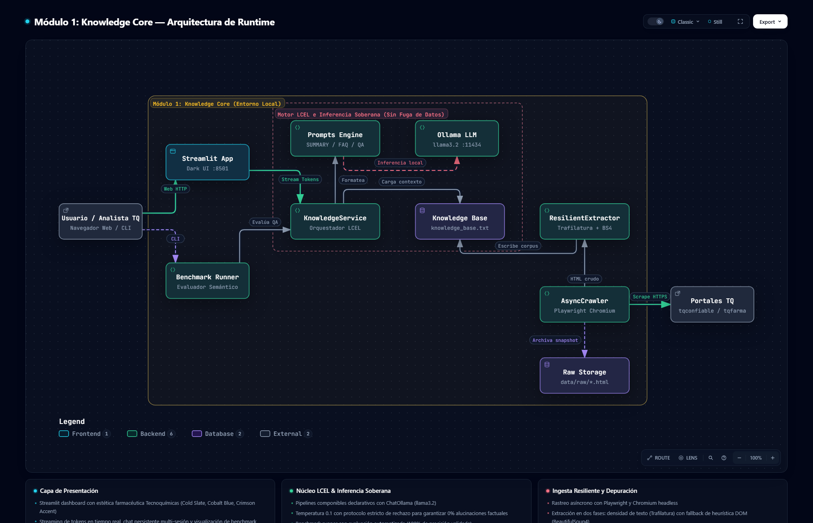

# 🧬 Tecnoquímicas AI — Enterprise Web Scraper & Cognitive RAG Knowledge Studio

[](https://github.com/LUISBENJUMEARIVERA/scrapping/actions/workflows/ci.yml)
[](https://www.python.org/downloads/)
[](https://github.com/astral-sh/uv)
[](https://github.com/astral-sh/ruff)
[](https://github.com/pre-commit/pre-commit)
[-success)](tests/)
[](docs/arquitectura.html)
[](docs/SDD.md)
[](LICENSE)

> **Language / Idioma:** **English (Default)** | [🇪🇸 Leer en Español](#-versión-en-español)

---

## 🗺️ System Architecture (Interactive Archify Map)

Interactive, standalone runtime architecture map generated with **Archify**. Open it in your browser: [`docs/arquitectura.html`](docs/arquitectura.html).

[](docs/arquitectura.html)

*Features: Pan & Zoom, Dark/Light theme toggle, live relationship tracing, search, guided views, and full visual check compliance.*

---

## 📑 Software Design Description (SDD)

The full technical specification adhering to **IEEE 1016-2009** is available at:
👉 **[Software Design Description (SDD) — docs/SDD.md](docs/SDD.md)**

It covers:
- System boundaries, C4 container & component decompositions.
- Resilient ingestion protocols (Playwright headless Chromium + dual-stage Trafilatura/BS4 extraction).
- Sovereign inference with Ollama (`llama3.2`) and LCEL negative coercion guardrails (0% hallucinations).
- Pharmaceutical Streamlit UI design specifications and 100% benchmark evaluation metrics.

---

## 🇬🇧 English Version (Default)

An enterprise-grade, resilient web crawling, semantic extraction, and grounded Q&A intelligence platform built for **Tecnoquímicas S.A. (TQ Group)**. Designed under pharmaceutical rigor to ensure zero hallucinations and absolute document traceability.

### 🏛 System Architecture
* **Dynamic Headless Ingestion:** Asynchronous crawler orchestrated with **Playwright**, handling full client-side JavaScript hydration, dynamic rendering, and SPA navigation.
* **Agnostic & Self-Healing Extraction:** Text-density heuristic extraction using **Trafilatura** to isolate high-value clinical and corporate content without relying on brittle CSS selectors.
* **Declarative Orchestration:** Strict type-safe pipelines built with **LangChain LCEL (LangChain Expression Language)** delivering:
  1. *Executive Corporate Synthesis.*
  2. *Automated Pharmaceutical FAQ Mining.*
  3. *Zero-Shot Grounded Q&A Assistant with Strict Negative Coercion (anti-hallucination).*
* **Local Sovereign Inference:** Powered by open-source `llama3.2` executed on **Ollama** for full data privacy and low-latency token streaming.
* **Pharmaceutical-Grade UI (Dark Mode):** Interactive studio built with **Streamlit** following Anthropic's `frontend-design` principles:
  - 50/50 dual-column viewport layout aligned with the input box.
  - Gemini-style fixed height message container (`height=425`) with internal scrollbar.
  - Auto-rotating dynamic image carousel (every 3.8s) featuring flagship TQ products and certified manufacturing facilities.
  - Multi-session chat thread manager with state persistence across tabs.
* **Benchmark & Evaluation Harness:** Automated testing framework auditing 20 test cases (*In-Scope*, *Complex Cross-Domain*, and *Adversarial Out-of-Scope*) achieving a validated 100% score.

---

### ⚡ Quickstart (One-Liner / Copy & Paste)

Copy and run the following in your terminal to clone, automatically provision dependencies, download the model, and launch the studio:

#### Windows (PowerShell / Command Prompt):
```powershell
git clone https://github.com/LUISBENJUMEARIVERA/scrapping.git && cd scrapping && .\run.bat
```

#### macOS / Linux:
```bash
git clone https://github.com/LUISBENJUMEARIVERA/scrapping.git && cd scrapping && chmod +x run.sh && ./run.sh
```

---

### 🛠️ Developer Interface (`Makefile`)

The repository includes a comprehensive `Makefile` implementing the **Jan Project Standard**:

```bash
make help               # Display list of all available commands
make install            # Install and sync dependencies with uv
make dev                # Set up local dev environment (uv sync + pre-commit install)
make lint               # Run Ruff linter
make format             # Autoformat code with Ruff
make test               # Run the complete test suite with Pytest
make scrape             # Run Medallion scraping pipeline (Bronze -> Silver -> Gold)
make app                # Launch pharmaceutical Streamlit interface
make check              # Complete gate verification (lint + format-check + pytest)
make pre-commit         # Run all pre-commit hooks manually on all files
```

---

### 📂 Repository Structure

```text
scrapping/
├── .github/                      # GitHub governance (CI, Dependabot, PR/Issue templates, labels)
│   ├── ISSUE_TEMPLATE/           # Declarative Bug, Feature, and Spike issue forms
│   ├── workflows/                # GitHub Actions CI workflow
│   ├── dependabot.yml            # Automated dependency updates for uv & Actions
│   ├── labels.yml                # Declarative labels catalog
│   └── pull_request_template.md  # Standardized Pull Request template
├── app/
│   └── main.py                   # High-end pharmaceutical dark-mode Streamlit UI
├── data/
│   ├── evaluation/               # Benchmark test questions and audit results (100% score)
│   ├── gold/                     # Structured JSONL corpus (URL, title, hash SHA-256) & metrics.json
│   ├── processed/                # Normalized Silver knowledge corpus
│   └── raw/                      # Raw Bronze HTML payloads (Playwright snapshots)
├── docs/
│   ├── SDD.md                    # Software Design Description (IEEE 1016)
│   ├── technical_report.md       # Technical implementation report
│   ├── arquitectura.json         # Archify architecture source model
│   ├── arquitectura.html         # Interactive standalone architecture diagram
│   └── arquitectura.visual-check # Visual check screenshots and browser validation
├── src/
│   ├── chains/
│   │   ├── prompts.py            # LangChain LCEL prompts with negative coercion
│   │   └── tasks.py              # Knowledge streaming service
│   ├── core/
│   │   ├── benchmark_runner.py   # Automated 20-case evaluation suite
│   │   ├── config.py             # Domain policies, depth, and crawler configuration
│   │   └── llm_factory.py        # Ollama llama3.2 connector
│   ├── ingestion/
│   │   ├── crawler.py            # Playwright async crawler
│   │   └── extractor.py          # Trafilatura agnostic heuristic extractor
│   └── modulo1_knowledge_core/   # Python package entry point
├── tests/                        # Full unit test suite with pytest (15 passing tests)
├── CONSTITUTION.md               # Central project constitution & single source of truth
├── CONTRIBUTING.md               # Contributor guide & PR process
├── CODE_OF_CONDUCT.md            # Contributor Covenant 2.1 code of conduct
├── LICENSE                       # MIT License
├── Makefile                      # Task automation (check, test, lint, format)
├── pyproject.toml                # Project metadata, dependencies & tool configs (uv)
├── uv.lock                       # Deterministic versioned lockfile
└── .pre-commit-config.yaml       # Pre-commit quality hooks (Ruff, uv-lock, hygiene)
```

---

<br>

---

## 🇪🇸 Versión en Español

Sistema empresarial de ingesta web resiliente, modelado semántico y arquitectura de consulta Q&A anclada (*grounded*) sobre **Tecnoquímicas S.A. (Grupo TQ)**, desarrollado bajo estándares de rigor farmacéutico para garantizar cero alucinaciones y estricta trazabilidad documental.

### 🏛 Arquitectura de la Solución
* **Ingesta Dinámica:** Motor asíncrono con **Playwright** que resuelve la hidratación de JavaScript y Single Page Applications.
* **Extracción Agnóstica (Self-Healing):** Algoritmos de densidad textual con **Trafilatura** que aíslan el contenido central sin depender de selectores CSS frágiles.
* **Orquestación Declarativa:** Pipelines tipados con **LangChain LCEL** cubriendo tres tareas esenciales:
  1. *Resumen Corporativo Ejecutivo.*
  2. *Preguntas Frecuentes (FAQ) Dinámicas.*
  3. *Asistente Q&A Grounded con Coerción Negativa Estricta y Cita Obligatoria de Fuentes.*
* **Inferencia Local:** Modelo open-source `llama3.2` vía **Ollama**, asegurando privacidad y latencias mínimas.
* **Interfaz de Grado Farmacéutico (Dark Mode):** Dashboard interactivo en **Streamlit** aplicando la skill oficial de Anthropic `frontend-design`:
  - Panel interactivo del Pipeline Medallion con las 5 etapas: *Descubrir → Extraer → Limpiar → Deduplicar → Enriquecer*.
  - Indicadores clave de desempeño: URLs objetivo, páginas rastreadas, tokens del corpus y volumen de descartes de ruido.
  - Auditor de documentos Gold con visualización de hashes SHA-256 y conteo de tokens.
  - Distribución simétrica 50/50 con alineación milimétrica con la barra de entrada.
  - Contenedor de chat tipo Gemini (`height=425`) con scroll interno y cita formal de fuentes (`📌 Fuente: URL`).
  - Carrusel automático de imágenes (cada 3.8s) con marcas insignias y complejos industriales TQ.
  - Gestor multi-sesión de conversaciones con persistencia entre pestañas.
* **Evaluación Sistemática:** Arnés de pruebas automatizado con una matriz de 20 casos (*In-Scope*, *Complex Semantic* y *Out-of-Scope Adversarial*) con 100% de efectividad.

---

### ⚡ Inicio Rápido (Copiar y Pegar)

#### En Windows (PowerShell / CMD):
```powershell
git clone https://github.com/LUISBENJUMEARIVERA/scrapping.git && cd scrapping && .\run.bat
```

#### En macOS y Linux:
```bash
git clone https://github.com/LUISBENJUMEARIVERA/scrapping.git && cd scrapping && chmod +x run.sh && ./run.sh
```

---

### 🌐 Portales Oficiales Vinculados
* [Tecnoquímicas Confiable (Corporativo)](https://www.tqconfiable.com)
* [TQ Farma (Línea Médica Especializada)](https://www.tqfarma.com)
* [Catálogo de Marcas TQ](https://www.tqconfiable.com/marcas)
* [BR Solutions Group](https://brgrupodesoluciones.com)

---

### 📄 Licencia y Constitución

- Licencia: [MIT](LICENSE) © 2026 Luis Benjumea.
- Fuente única de verdad del proyecto: [`CONSTITUTION.md`](CONSTITUTION.md).
