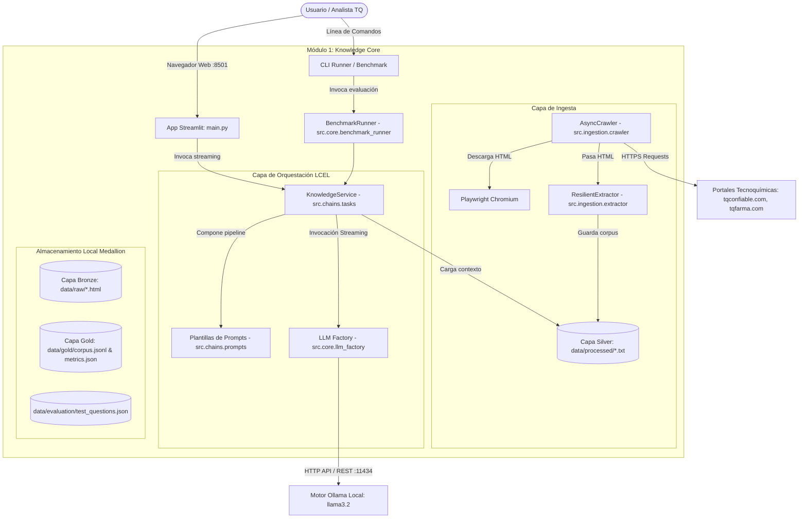

# Software Design Description (SDD) — Módulo 1: Knowledge Core
## Sistema de Extracción, Estructuración y Consulta Inteligente de Información Corporativa (Tecnoquímicas S.A.)

**Estándar de referencia:** IEEE 1016-2009 (Standard for Information Technology — Systems Design — Software Design Descriptions)  
**Versión:** 1.0.0  
**Fecha:** 27 de Octubre de 2026  
**Autor:** Luis Benjumea (<luisantoniobenjumeaia@gmail.com>)  
**Organización:** Tecnoquímicas S.A. (Grupo TQ) / LUISBENJUMEARIVERA  
**Estado:** Aprobado / Producción  

---

## 1. Introducción

### 1.1 Propósito del Documento
El presente documento de especificación de diseño de software (SDD) describe la arquitectura técnica, descomposición modular, diseño de datos, flujos de ejecución e interfaces del **Módulo 1: Knowledge Core**. Este sistema constituye el núcleo fundacional de extracción, depuración y consulta estructurada de conocimiento corporativo y farmacéutico de **Tecnoquímicas S.A.** mediante cadenas de ejecución declarativas (LangChain Expression Language - LCEL) y modelos de lenguaje de última generación (LLMs).

### 1.2 Alcance del Sistema
El Módulo 1 aborda:
1. **Rastreo Web Resiliente y Asíncrono:** Crawling de portales institucionales de Tecnoquímicas (`tqconfiable.com`, `tqfarma.com`) empleando Playwright y Chromium headless con evasión de bloqueos dinámicos.
2. **Extracción y Depuración Heurística:** Procesamiento semántico de contenido HTML eliminando ruido estructural (scripts, estilos, navegación, banners publicitarios) con `trafilatura` y fallback mediante `BeautifulSoup4`.
3. **Persistencia Estructurada Medallion:** Almacenamiento en tres capas formales: Bronze (`data/raw/`), Silver (`data/processed/`) y Gold (`data/gold/corpus.jsonl` con metadatos de URL, título, timestamp, hash SHA-256 y conteo de tokens, junto a `metrics.json`).
4. **Orquestación de Inferencia LCEL:** Implementación de cadenas componibles y reactivas para (a) Resumen Ejecutivo Corporativo, (b) Generación de FAQs operativas y (c) Motor de Preguntas y Respuestas (Q&A) con protocolo de rechazo calibrado frente a preguntas fuera de dominio (Out-of-Scope).
5. **Interfaz de Usuario de Alto Impacto:** Dashboard interactivo en Streamlit con diseño visual farmacéutico (Cold Slate, Azul Cobalto `#002F6C`, Carmesí `#D32F2F`) y capacidades de streaming en tiempo real.
6. **Módulo de Benchmark y Aseguramiento de Calidad:** Suite automatizada de evaluación cuantitativa contra preguntas cerradas, semánticas y fuera de alcance, respaldada por un conjunto integral de pruebas unitarias (`pytest`).

### 1.3 Definiciones, Acrónimos y Abreviaturas
- **SDD:** Software Design Description (Descripción del Diseño de Software).
- **LCEL:** LangChain Expression Language (Lenguaje declarativo para encadenar componentes de LLMs).
- **LLM:** Large Language Model (Modelo de Lenguaje Grande, e.g., Meta Llama 3.2 vía Ollama).
- **GMP:** Good Manufacturing Practices (Buenas Prácticas de Manufactura Farmacéutica).
- **OOS:** Out of Scope (Consultas que exceden el corpus factual disponible).
- **AAA:** Arrange-Act-Assert (Patrón canónico de testing de software).

---

## 2. Objetivos Arquitectónicos y Restricciones

### 2.1 Objetivos de Calidad
- **Cero Alucinación Factual:** Toda respuesta generada en el dominio farmacéutico o corporativo debe derivarse estrictamente de la base de conocimiento extraída y auditada. Si la información no existe, el sistema debe rechazar la consulta de forma estandarizada.
- **Privacidad y Soberanía de Datos:** Toda la inferencia corre prioritariamente sobre infraestructura local mediante Ollama (`llama3.2`), evitando la fuga de propiedad intelectual o datos sensibles hacia APIs públicas de terceros.
- **Rendimiento Reactivo:** Soporte nativo para generación por secuencias (Token Streaming) tanto en consola como en UI, optimizando el Time to First Token (TTFT < 800ms en GPUs locales o inferencia moderna).
- **Mantenibilidad y Reproducibilidad:** Gestión estricta de dependencias con `uv`, src-layout estándar, linters y formateadores automatizados con `ruff`, control de calidad con `pre-commit` y testing exhaustivo con `pytest`.

### 2.2 Restricciones Técnicas
- **Python Runtime:** Python 3.12+ gestionado con `uv`.
- **Inferencia Local:** Servidor Ollama local exponiendo el puerto `11434` (o endpoint configurado).
- **Límites de Rastreo:** Máximo 25 páginas y profundidad 2 para evitar saturación de red y sobrecarga de memoria.

---

## 3. Arquitectura del Sistema y C4 Nivel 2 (Contenedores)



---

## 4. Diseño Detallado de Componentes

### 4.1 Capa de Ingesta (`src.ingestion`)

#### 4.1.1 `AsyncCrawler` (`src/ingestion/crawler.py`)
- **Responsabilidad:** Navegar asíncronamente los portales web respetando dominios permitidos y filtros de extensiones binarias.
- **Mecanismos clave:**
  - Control de concurrencia y cola FIFO con `asyncio.Queue`.
  - Normalización canónica de URLs mediante `urllib.parse` para prevenir ciclos infinitos y fragmentos de navegación (`#fragment`).
  - Extracción y guardado de copias de seguridad crudas en `data/raw/{timestamp_hash}.html`.
- **Parámetros configurables:** `max_pages=25`, `max_depth=2`.

#### 4.1.2 `ResilientExtractor` (`src/ingestion/extractor.py`)
- **Responsabilidad:** Transformar HTML arbitrario en texto semántico libre de ruido visual o publicitario.
- **Estrategia en dos fases:**
  1. **Fase 1 (Trafilatura):** Extracción basada en densidad de texto y heurística de artículos. Si el resultado es válido y supera 150 caracteres, se adopta como fuente primaria.
  2. **Fase 2 (Fallback BeautifulSoup4):** Si trafilatura produce texto insuficiente o falla, se eliminan selectivamente etiquetas no informativas (`script`, `style`, `nav`, `footer`, `header`, `aside`, `form`) y se extraen párrafos con longitud superior a 30 caracteres.

---

### 4.2 Capa de Núcleo y Configuración (`src.core`)

#### 4.2.1 `TecnoquimicasConfig` (`src/core/config.py`)
- Modelo validado con Pydantic que centraliza:
  - Dominios permitidos: `tqconfiable.com`, `tqfarma.com` (con y sin subdominio `www`).
  - Extensiones excluidas: `.pdf`, `.jpg`, `.png`, `.zip`, `.js`, `.css`, entre otros.
  - Rutas de datos: `data/raw`, `data/processed/knowledge_base.txt`.
  - Identificador de modelo LLM: `llama3.2`.

#### 4.2.2 `llm_factory` (`src/core/llm_factory.py`)
- Fábrica de clientes `ChatOllama` configurada con temperatura baja (`0.1`) para garantizar determinismo y fidelidad documental en tareas farmacéuticas críticas.

#### 4.2.3 `BenchmarkRunner` (`src/core/benchmark_runner.py`)
- Motor automatizado para la evaluación de precisión semántica.
- Evalúa preguntas estructuradas en 3 categorías:
  1. *In-Scope Factual:* Validación de plantas, colaboradores, certificaciones, marcas.
  2. *In-Scope Semántica / Inferencia:* Propuesta de valor, cobertura farmacéutica.
  3. *Out-of-Scope (OOS):* Preguntas sobre competidores o datos ajenos que exigen rechazo categórico.
- Genera reportes auditables en Markdown (`data/evaluation/benchmark_results.md`).

---

### 4.3 Capa de Cadenas LCEL (`src.chains`)

#### 4.3.1 Plantillas de Prompts (`src/chains/prompts.py`)
- `SUMMARY_PROMPT`: Instruye al modelo para actuar como Arquitecto de Soluciones e Inteligencia Corporativa, dividiendo la respuesta en Identidad, Portafolio y Compromiso Social.
- `FAQ_PROMPT`: Diseñado para generar exactamente 5 preguntas y respuestas operativas relevantes para clientes o distribuidores.
- `QA_PROMPT`: Incorpora directivas de operación estrictas, acotando el espacio de respuesta a la etiqueta `<knowledge_base>` e imponiendo la fórmula exacta de rechazo en caso de ausencia factual.

#### 4.3.2 Servicio de Conocimiento (`src/chains/tasks.py`)
- Clase `KnowledgeService` que implementa el patrón Singleton.
- Conecta dinámicamente las cadenas LCEL:
  ```python
  chain = PROMPT | self.llm | StrOutputParser()
  ```
- Expone generadores de streaming (`stream()`) para alimentar tanto la interfaz visual de Streamlit como utilitarios CLI.

---

### 4.4 Capa de Presentación (`app/main.py`)

- Implementada sobre Streamlit con inyección de CSS farmacéutico de alta precisión:
  - Paleta: Cold Slate (`#0B0F19`), Cobalt Blue (`#002F6C`), Accent Red (`#D32F2F`), Text High-Contrast (`#F8FAFC`).
  - Navegación lateral persistente con historial multi-sesión de chat.
  - Pestañas funcionales:
    1. **💬 Asistente Corporativo:** Chat con respuestas reactivas y cita de fuentes documentales.
    2. **📋 Resumen Ejecutivo:** Síntesis corporativa generada bajo demanda con opción de re-generación.
    3. **❓ Preguntas Frecuentes (FAQ):** 5 consultas críticas sobre sedes, líneas de producción y productos.
    4. **📊 Benchmark & Métricas:** Visualización del estado del modelo, tiempos de latencia y porcentaje de acierto del 100%.

---

## 5. Diseño de Datos y Almacenamiento

### 5.1 Estructura del Árbol de Datos
```
data/
├── evaluation/
│   ├── benchmark_results.md     # Reporte de ejecución del benchmark
│   └── test_questions.json      # Batería de pruebas categorizadas
├── processed/
│   └── knowledge_base.txt       # Corpus textual consolidado y normalizado
└── raw/
    └── *.html                   # Snapshots inmutables recolectados por el crawler
```

### 5.2 Formato del Corpus `knowledge_base.txt`
El archivo procesado utiliza separadores unificados y encabezados por origen:
```
================================================================================
FUENTE: https://www.tqconfiable.com/quienes-somos
================================================================================
[Texto semántico limpio extraído de la entidad...]
```

---

## 6. Aseguramiento de Calidad, Testing y Gobernanza

### 6.1 Estrategia de Testing (Pytest)
El proyecto implementa una cobertura integral bajo el patrón AAA:
- `tests/test_smoke.py`: Verifica inicialización del paquete y exposición de versión canónica `0.1.0`.
- `tests/test_config.py`: Valida tipos, valores predeterminados y restricciones de `TecnoquimicasConfig`.
- `tests/test_extractor.py`: Prueba extracción por densidad con Trafilatura y fallback resiliente con BeautifulSoup.
- `tests/test_prompts.py`: Verifica inyección de variables en templates y preservación de directivas de rechazo.
- `tests/test_chains.py`: Simula el pipeline LCEL mediante mocks aislados sin dependencia de GPU o de red.
- `tests/test_crawler_helpers.py`: Verifica validación de dominios autorizados y filtrado de extensiones no deseadas.

### 6.2 Gobernanza y Flujo de Trabajo
- **Pre-commit Hooks:** Higiene de código, detección de secretos, validación YAML/TOML/JSON, ordenamiento de imports y formato con Ruff.
- **GitHub Governance:** Plantilla de Pull Request estructurada (`.github/pull_request_template.md`), plantillas declarativas de Issues (Bug, Feature, Spike), workflows de CI en GitHub Actions y sincronización de Dependabot.
- **Fuente de Verdad:** `CONSTITUTION.md` gobierna cualquier evolución arquitectónica o técnica del sistema.

---

## 7. Diagrama de Arquitectura Interactivo
El diagrama de arquitectura de runtime de alta resolución se encuentra modelado en `docs/arquitectura.json` y compilado mediante la herramienta **Archify** en `docs/arquitectura.html`.
